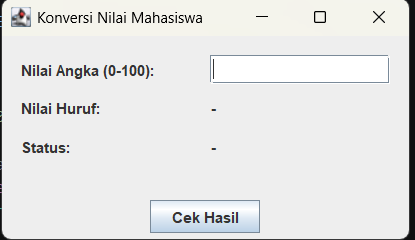
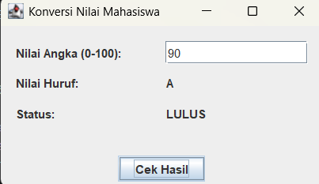

# tugas-java-gui
# Aplikasi Cek Kelulusan & Konversi Nilai (Java Swing GUI)

Aplikasi GUI sederhana untuk mengonversi nilai angka (0–100) menjadi nilai huruf (A–E) beserta status kelulusan.
## 5 Komponen Utama GUI yang Digunakan

1. **Top-level Container Class:**
   * `JFrame`: Jendela utama aplikasi (`CekNilai extends JFrame`).
2. **Intermediate Container Class:**
   * `JPanel`: Wadah untuk mengelompokkan komponen form (`panelUtama`) dan tombol (`panelBawah`).
3. **Atomic Component Class:**
   * `JLabel`: Menampilkan teks keterangan, nilai huruf, dan status kelulusan.
   * `JTextField`: Kolom input untuk memasukkan nilai angka.
   * `JButton`: Tombol pemicu pengecekan nilai (`btnCek`).
   * `JOptionPane`: Pop-up dialog untuk peringatan kesalahan input.
4. **Layout Classes (3 Layout):**
   * `BorderLayout`: Tata letak utama pada `JFrame` (`CENTER` dan `SOUTH`).
   * `GridLayout`: Menyusun label dan kolom input pada `panelUtama` dalam 3 baris x 2 kolom.
   * `FlowLayout`: Menyusun posisi tombol pada `panelBawah`.
5. **Event Listener:**
   * `ActionListener` (Interface): Diimplementasikan pada `btnCek` dengan meng-override method `actionPerformed(ActionEvent e)` untuk memproses logika konversi nilai saat tombol diklik.
## Screenshot Aplikasi

### 1. Tampilan Awal

### 2. Tampilan Setelah Nilai Dicek

